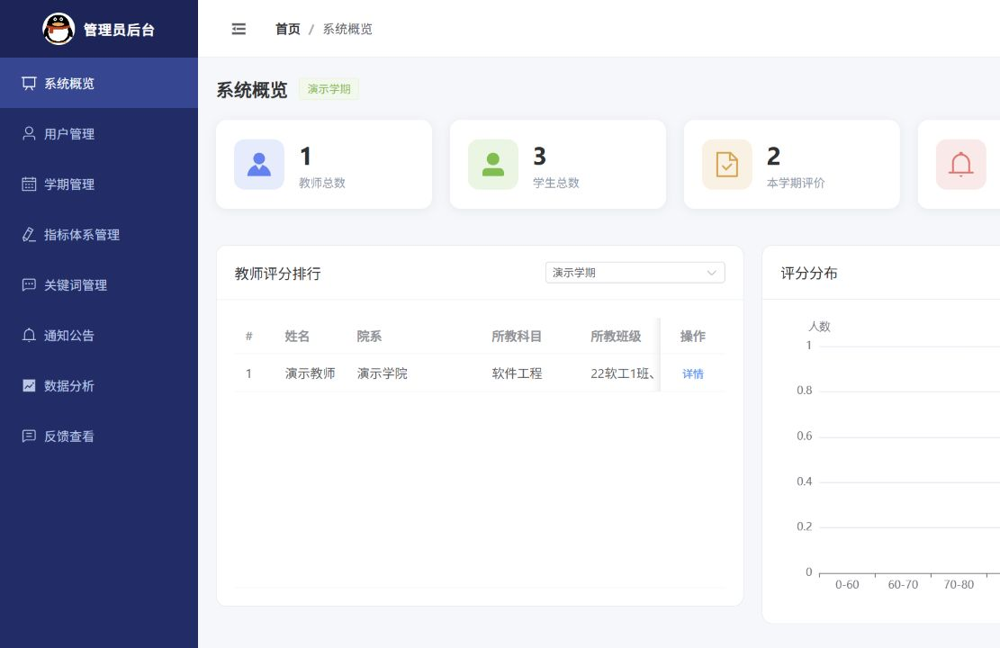

# 教师教学质量评价智能分析系统

陈文坤本科毕业设计。基于 Spring Boot、Vue 3 和 Python，包含学生、教师、管理员三个角色，以及 uni-app 微信小程序客户端。

支持问卷评价、历史记录、教师反馈、用户与学期管理、统计分析、动态权重、聚类分析和教学改进报告。Python 微服务使用中文情感分类模型，结合方面词规则分析教学态度、课程难度、表达清晰度、互动性和教学内容。



## 技术与目录

- `backend/`：Java 17+、Spring Boot 3.2.3、Spring Security、JWT、MyBatis Plus。
- `frontend/`：Vue 3、Vite、Element Plus、Pinia、ECharts。
- `miniprogram/`：uni-app、Vue 3、微信小程序。
- `nlp_service/`：Flask、Transformers、PyTorch。
- `sql/schema.sql`：完整建表脚本，包含评价参与度字段和前置问题权重配置表。
- `sql/demo-data.sql`：虚构演示账号、授课关系、12道单选题、1道简答题和关键词。
- `scripts/smoke_test.py`：登录、权限、评价、反馈与统计的接口验证。

## 本地启动

需要 JDK 17+、Maven 3.8+、Node.js 18+、MySQL 8、Redis，以及 Python 3.10+。本次验证使用 Java 21、Node.js 20、Python 3.12。

### 1. 初始化全新的演示数据库

在 MySQL 客户端中，切换到项目目录后执行：

```sql
source sql/schema.sql
source sql/demo-data.sql
```

默认数据库名为 `teach_eval`。如需其他名称，先修改两份脚本中的数据库名，并设置后端的 `DB_URL`。只向**全新的演示数据库**导入；数据脚本不能重复导入，`CREATE TABLE IF NOT EXISTS` 也不会升级已有表结构。

公开仓库仅包含虚构演示数据。本地保留的历史 SQL 和个人数据文件不在 Git 跟踪范围内。

### 2. 配置数据库与密钥

在项目根目录执行：

```powershell
Copy-Item application-local.example.yml application-local.yml
python -c "import secrets; print(secrets.token_urlsafe(48))"
```

在 `application-local.yml` 填入本机 MySQL 密码，并把随机生成的值填入 `jwt.secret`。这个本地文件不会上传 GitHub。Spring Boot 从项目根目录或 `backend/` 启动时均可加载它。

也可配置环境变量：`DB_URL`、`DB_USER`、`DB_PASSWORD`、`JWT_SECRET`、`REDIS_HOST`、`REDIS_PORT`、`REDIS_PASSWORD`、`REDIS_DATABASE`、`NLP_SERVICE_URL`、`SERVER_PORT` 和 `UPLOAD_PATH`。如本地文件已经写入某项设置，请修改该文件，或删除对应配置项后再改用环境变量。

### 3. 启动 Python 情感分析

Windows 可以运行 `nlp_service/start.bat`。也可在 `nlp_service/` 手动执行：

```powershell
python -m venv .venv
.\.venv\Scripts\python.exe -m pip install -r requirements.txt
$env:HF_HOME = "$PWD\..\.run\huggingface"
.\.venv\Scripts\python.exe app.py
```

首次启动需要从 Hugging Face 下载模型。默认地址为 `http://127.0.0.1:5001`，健康检查为 `/health`；`model_loaded: true` 表示模型已加载。`/absa` 的 `analysisMethod` 区分 `bert` 与词典降级 `fallback`，不能把降级结果当作模型推理。可用 `NLP_MODEL_PATH` 指定已下载的模型目录。

默认模型为 `uer/roberta-base-finetuned-dianping-chinese`，输出正面、负面两类，分数由正面概率转换后按方面词匹配聚合。它不是经过教学场景标注校准的质量评分，也不是专门训练的方面级分类器。参见[原模型标签配置](https://huggingface.co/uer/roberta-base-finetuned-dianping-chinese/blob/main/config.json)。

### 4. 启动后端

先启动 MySQL 和 Redis。确认 `java -version` 为17或以上，再在 `backend/` 执行：

```powershell
mvn spring-boot:run
```

Windows 也可以双击根目录 `start-backend.bat`。如果默认 Java 过旧，可以在根目录新建不会上传的 `.local-env.ps1`：

```powershell
$env:JAVA_HOME = '你的JDK17或以上版本的安装目录'
```

默认 API 地址：`http://localhost:8080/api`；接口文档：`http://localhost:8080/api/doc.html`。

### 5. 启动网页前端

在 `frontend/` 执行：

```powershell
npm ci
npm run dev
```

访问 `http://localhost:5173`。开发服务器将 `/api` 请求代理到后端。演示密码均为 `123456`，账号分别为管理员 `admin`、教师 `demo_teacher`、学生 `demo_student`。登录时请选择对应身份。

### 6. 微信小程序（可选）

在 `miniprogram/` 执行：

```powershell
npm ci
npm run build:mp-weixin
```

用微信开发者工具导入 `miniprogram/dist/build/mp-weixin`。真机调试前将 `src/utils/request.js` 改为手机可访问的后端地址。构建成功不代表已经完成微信真机验证。

## 验证

依赖服务运行、配置就绪后，分别在对应目录执行：

```text
backend/:      mvn package
frontend/:     npm run build
miniprogram/:  npm run build:mp-weixin
nlp_service/:  .\.venv\Scripts\python.exe -m unittest -v test_app
项目根目录:    python scripts/smoke_test.py --demo-data
```

接口测试应仅连接用上述演示数据初始化的独立测试库；会创建测试学生、提交评价并更新演示教师反馈。可用 `--base-url` 指定服务地址。详细本机结果见 `VERIFICATION.md`，不代表覆盖所有页面、输入边界或微信真机环境。

## 演示用途

保留了本科毕设原有的演示认证实现，包括明文密码比对和宽松跨域设置。默认账号仅用于本地展示。实际部署前需替换密码存储方式、收紧注册与访问策略，并配置 HTTPS、数据库最小权限与密钥管理。仓库提供源代码，不包含线上系统部署。
